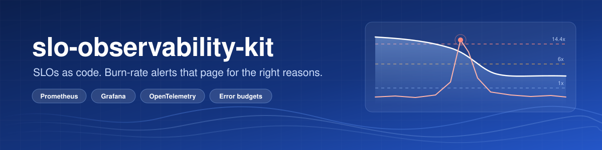
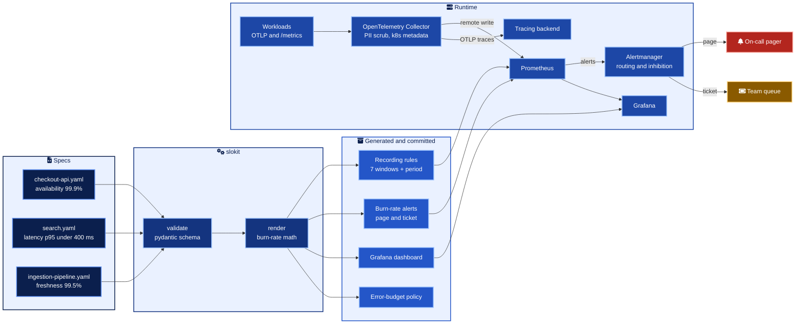
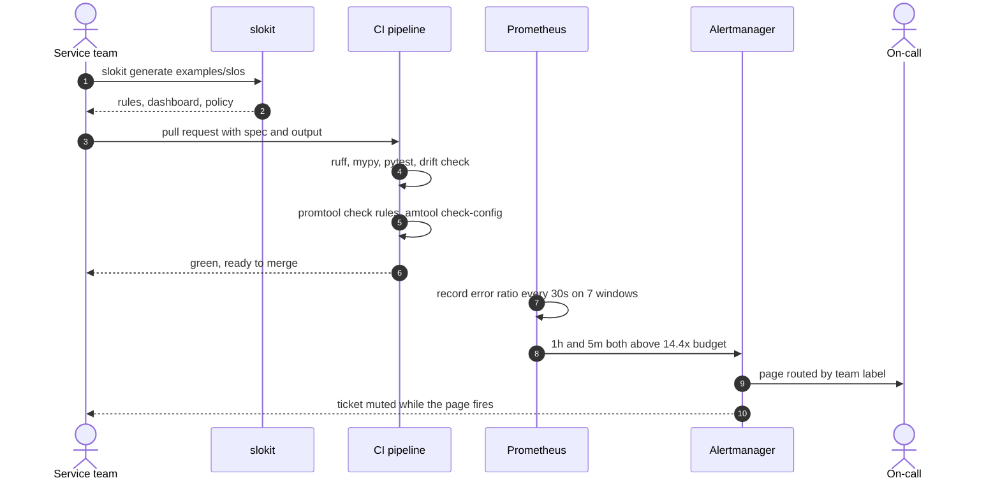

<div align="center">



<h1>slo-observability-kit</h1>

<p>Describe an SLO in a short YAML file. Get the recording rules, multi-window burn-rate alerts, Grafana dashboard and error-budget policy that make it real.</p>

<p>


</p>

</div>

## In numbers

| What | Count | Measured with |
| --- | --- | --- |
| Example services and SLOs | 3 | `slokit validate examples/slos` |
| Prometheus rules generated | 48 (42 recording, 6 alerting) | `slokit generate examples/slos` |
| Error ratio windows per SLO | 7 (5m to 3d) plus the SLO period | `SLI_WINDOWS` in `src/slokit/burnrate.py` |
| Burn-rate window pairs | 4 (2 page, 2 ticket) | `DEFAULT_POLICY` in `src/slokit/burnrate.py` |
| Dashboard panels generated | 21 across 3 dashboards | `examples/generated/grafana/dashboards/` |
| Tests | 97, all passing | `pytest` |

## What it is

A small, typed generator and a local stack for running SLOs the way the SRE workbook
describes them. Teams describe what good looks like for their service. slokit turns that
into PromQL that pages only when the error budget is genuinely at risk, a dashboard that
shows how much budget is left, and a written policy that says what happens when it runs out.

It is built for platform teams who want every service to get the same, reviewed alerting
math instead of a hand-copied rule file per team.

## Architecture



## From spec to page



## Quick start

```bash
python3 -m venv .venv && source .venv/bin/activate
pip install -e ".[dev]"

slokit validate examples/slos
slokit generate examples/slos -o examples/generated
slokit burn-rates --objective 99.9 --window 28d

docker compose up -d
```

| Open | For |
| --- | --- |
| <http://localhost:3000> | Grafana, folder "SLOs", one dashboard per service |
| <http://localhost:9090/alerts> | Prometheus rules and alert states |
| <http://localhost:9093> | Alertmanager routing and silences |
| <http://localhost:16686> | Jaeger, traces received through the collector |

Simulate an incident by raising the checkout error ratio to 5%. That is 50 times the budget,
and the page alert fires within about 20 minutes.

```bash
CHECKOUT_ERROR_RATIO=0.05 docker compose up -d demo-service
```

## A spec

```yaml
apiVersion: slokit/v1
service: checkout-api
owner: payments-team
alerting:
  page: { team: payments-oncall, channel: "#payments-oncall" }
  ticket: { team: payments-team }
  runbook_url: https://runbooks.example.com/checkout-api
slos:
  - name: availability
    description: Checkout requests that do not fail with a server error.
    objective: 99.9
    window: 28d
    sli:
      type: availability
      template:
        metric: http_server_requests_total
        selector: service="checkout-api"
        good_filter: code!~"5.."
```

| SLI type | Template inputs | Good event |
| --- | --- | --- |
| `availability` | `metric`, `selector`, `good_filter` | A request matching `good_filter` |
| `latency` | `metric`, `selector`, `le` | A request in the histogram bucket `le` |
| `freshness` | `metric`, `selector`, `max_age_seconds` | A minute in which the last success is recent enough |
| any | `queries.good`, `queries.total` | Whatever your PromQL says, with a `{{window}}` placeholder |

## Burn-rate policy

| Severity | Burn rate | Long / short window | Error ratio at 99.9% | Budget spent when it fires (30d) | Budget gone in |
| --- | --- | --- | --- | --- | --- |
| page | 14.4x | 1h / 5m | 1.44% | 2% | 50 h |
| page | 6x | 6h / 30m | 0.6% | 5% | 120 h |
| ticket | 3x | 1d / 2h | 0.3% | 10% | 240 h |
| ticket | 1x | 3d / 6h | 0.1% | 10% | 720 h |

Both windows must be above the threshold. The long one proves the burn matters, the short
one proves it is still happening. The derivation, detection times and the 28 day variant
are in [docs/burn-rate-math.md](docs/burn-rate-math.md).

## What gets generated

| Output | Path | Highlights |
| --- | --- | --- |
| Recording rules | `prometheus/rules/<service>.rules.yaml` | `slo:sli_error:ratio_rate{5m..3d}`, period ratio, objective, budget, burn rates |
| Alert rules | same file | One page and one ticket alert per SLO, `severity`, `team`, `runbook_url`, `dashboard` |
| Dashboard | `grafana/dashboards/<service>.json` | SLI over the period, budget remaining, burn rate per alert window with threshold lines |
| Policy | `policies/<service>.md` | Budget in minutes, routing table, actions at 50%, 25% and 0% budget left |

An empty good series is treated as zero good events (`or vector(0)`), so a total outage
pages instead of returning no data.

## Delivery


Every action is pinned to a commit SHA and the job runs with `contents: read` only.

## Before you rely on it

> [!WARNING]
> Files under `examples/generated/` are overwritten on every run and CI fails if they drift.
> Change the spec, never the output.

> [!CAUTION]
> Raw `good` and `total` queries must each return one series without labels. A `sum by (...)`
> silently breaks the ratio and the zero-good guard. Wrap them in a plain `sum()`.

> [!IMPORTANT]
> A freshness SLI cannot see a pipeline whose timestamp metric disappears altogether. Pair it
> with an `absent()` alert on the same metric.

> [!NOTE]
> The page goes to the receiver matching the `team` label. A team missing from
> `alertmanager/alertmanager.yml` falls through to the default receiver, so add the route in the
> same pull request.

## Repository map

| Path | What lives there |
| --- | --- |
| `src/slokit/` | Schema (`models.py`), math (`burnrate.py`), rules, dashboards, policies, CLI |
| `tests/` | Burn-rate math, schema errors, PromQL parsing, golden files, CLI |
| `examples/slos/` | Three synthetic services, one per SLI type |
| `examples/generated/` | Committed output, checked for drift in CI |
| `otel/` | Collector config (production shape) and the local overlay |
| `prometheus/` | Local Prometheus config, loads the generated rules |
| `alertmanager/` | Routing tree, inhibition rules, working-hours interval for tickets |
| `grafana/` | Datasource and dashboard provisioning |
| `demo/` | Synthetic workload that emits the three example SLIs |
| `docs/` | Primer, burn-rate math, onboarding, runbook template, ADRs |

## Documentation

| Document | Read it to |
| --- | --- |
| [SLO primer](docs/slo-primer.md) | Agree on SLI, SLO, error budget and burn rate in five minutes |
| [Burn-rate math](docs/burn-rate-math.md) | See why 14.4x, how fast each alert fires and what it costs |
| [Onboard a service](docs/onboarding.md) | Go from no SLO to merged alerts in three steps |
| [Incident runbook template](docs/runbooks/incident-response-template.md) | Respond to a page with a plan |
| [ADR 0001](docs/adr/0001-multi-window-multi-burn-rate-alerts.md) | Why multi-window, multi-burn-rate alerts |
| [ADR 0002](docs/adr/0002-time-weighted-period-sli.md) | Why the period SLI is time-weighted |
| [ADR 0003](docs/adr/0003-generate-rules-from-specs.md) | Why rules are generated and committed |

<div align="center">
<sub>MIT licensed. Built and maintained by Giselle Da Costa.</sub>
</div>
