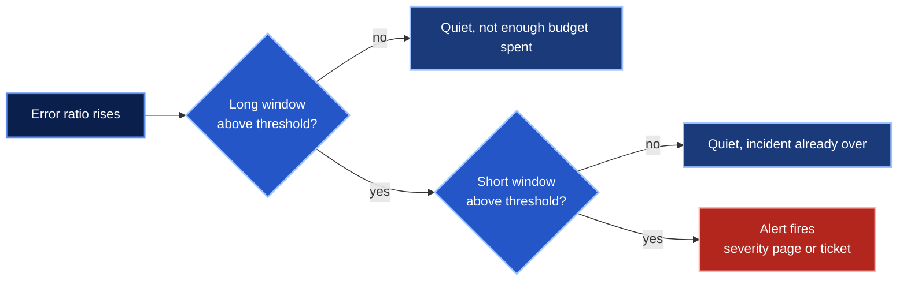

# Burn-rate math

Static thresholds on error rate either page on noise or stay silent through a slow leak.
Burn-rate alerts ask a better question instead, namely how fast the error budget is
going and whether it will last until the end of the window.

## Definitions

```text
error_budget  = 1 - objective                       0.001 for 99.9%
burn_rate     = error_ratio / error_budget           1 means the budget lasts exactly one window
threshold     = burn_rate * error_budget             error ratio that triggers the alert
budget_spent  = burn_rate * long_window / period     share of the budget gone when it fires
exhaustion    = period / burn_rate                   time left at that pace with a full budget
detection     = long_window * threshold / error_ratio   time to fire after a step change
```

Every formula above is implemented in `src/slokit/burnrate.py` and pinned by tests in
`tests/test_burnrate.py`.

## The policy

Four window pairs, two severities. Each alert fires only when both its long and its
short window are above the threshold.

| Severity | Burn rate | Long window | Short window | Budget spent (30d) | Budget spent (28d) | Exhausted in (30d) | Error ratio at 99.9% |
| --- | --- | --- | --- | --- | --- | --- | --- |
| page | 14.4x | 1h | 5m | 2% | 2.14% | 50 h | 1.44% |
| page | 6x | 6h | 30m | 5% | 5.36% | 120 h | 0.6% |
| ticket | 3x | 1d | 2h | 10% | 10.71% | 240 h | 0.3% |
| ticket | 1x | 3d | 6h | 10% | 10.71% | 720 h | 0.1% |

The burn rates are the ones from the SRE workbook, defined for a 30 day window. slokit
keeps them for 28 day SLOs too, which makes each alert spend slightly more budget before
it fires. Run `slokit burn-rates --objective 99.9 --window 28d` to print the table for any
objective.

## Why two windows



The long window gives precision, since a few bad minutes cannot trip a one hour average.
The short window, one twelfth as long, gives a fast reset, so the alert clears minutes
after the fix instead of an hour later.

## How fast it fires

Time to the first alert after the error ratio jumps and stays there, for a 99.9% SLO.
The `for` clause on each alert (2m for pages, 15m for tickets) comes on top.

| Sustained error ratio | First alert | Fires after |
| --- | --- | --- |
| 100% (full outage) | page, 14.4x 1h/5m | 0.9 min |
| 10% | page, 14.4x 1h/5m | 8.6 min |
| 2% | page, 14.4x 1h/5m | 43.2 min |
| 1% | page, 6x 6h/30m | 3.6 h |
| 0.5% | ticket, 3x 1d/2h | 14.4 h |
| 0.2% | ticket, 1x 3d/6h | 36 h |
| 0.09% | none, the budget lasts the window | |

## Low objectives

At a 14.4x burn the threshold is `14.4 * (1 - objective)`. Below an objective of 93.06% that
is above 100%, so the page could never fire. slokit refuses such a spec and says why,
instead of generating an alert that looks fine and never fires.
