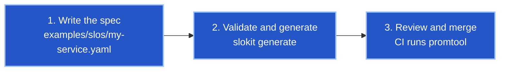

# Onboard a service in three steps

From nothing to burn-rate alerts, a dashboard and an error-budget policy.



## 1. Write the spec

Copy the closest example and change the service, the owner and the metric selectors.

| You want to measure | Start from | SLI type |
| --- | --- | --- |
| Requests that succeed | `examples/slos/checkout-api.yaml` | `availability` |
| Requests faster than a threshold | `examples/slos/search.yaml` | `latency` |
| Data or jobs that are recent enough | `examples/slos/ingestion-pipeline.yaml` | `freshness` |

Templates cover the common shapes. When they do not fit, use `queries` with raw PromQL.
Both queries must return a single series without labels (wrap them in `sum()`), and both
must contain the `{{window}}` placeholder.

```yaml
sli:
  type: availability
  queries:
    good: sum(rate(grpc_server_handled_total{grpc_service="cart",grpc_code="OK"}[{{window}}]))
    total: sum(rate(grpc_server_handled_total{grpc_service="cart"}[{{window}}]))
```

## 2. Validate and generate

```bash
slokit validate examples/slos
slokit generate examples/slos -o examples/generated
```

Validation reports every problem in every file at once, with the path to the field.

```text
error: examples/slos/cart.yaml: 2 problem(s) in the SLO spec
  - alerting.page.team: 'Cart On-Call' is not allowed here, use 2 to 63 lowercase letters, digits or hyphens, starting with a letter
  - slos.0: objective 90% leaves a 10% error budget, so a 14.4x burn would need an error ratio of 144% and the page alert could never fire. Use an objective above 93.06%
```

## 3. Review and merge

Commit the spec and the generated files together. CI regenerates them and fails on any
difference, then runs `promtool check rules` and `amtool check-config`. Before merging,
check three things by hand:

- The `team` labels match a route in `alertmanager/alertmanager.yml`, otherwise pages land
  in the default receiver.
- The runbook URL opens, and has a section for each SLO name.
- The owning team has read the generated policy in `examples/generated/policies/` and
  agrees to what happens when the budget runs out.
